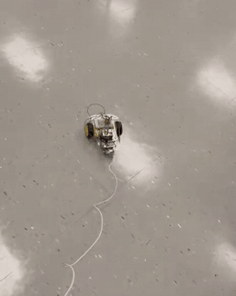
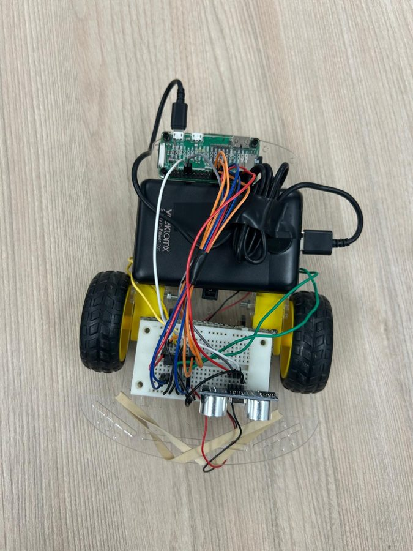
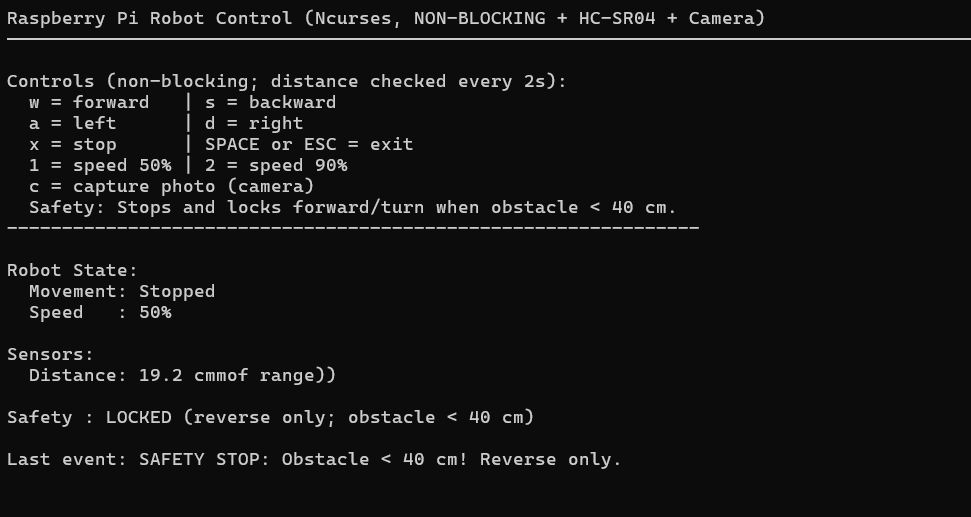
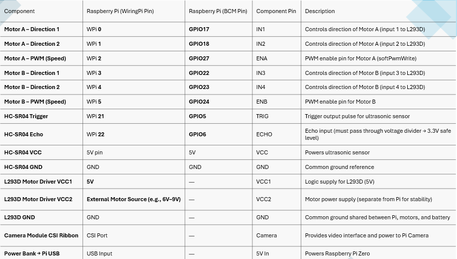
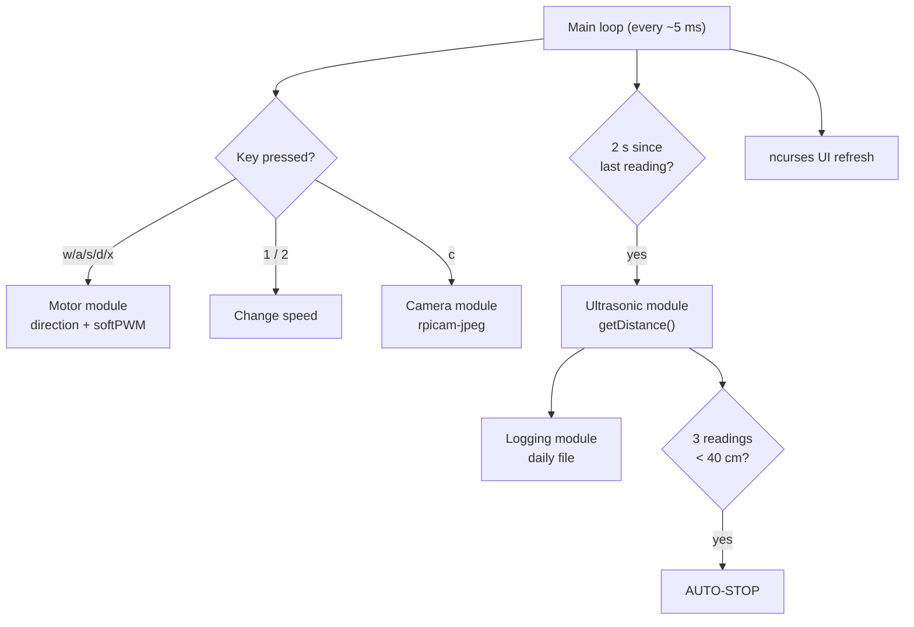
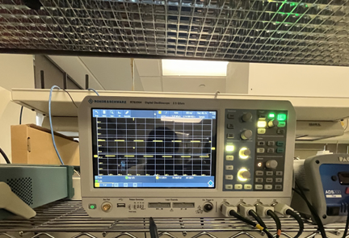
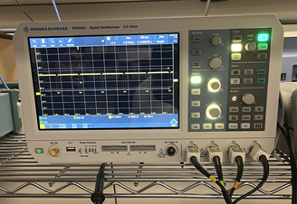
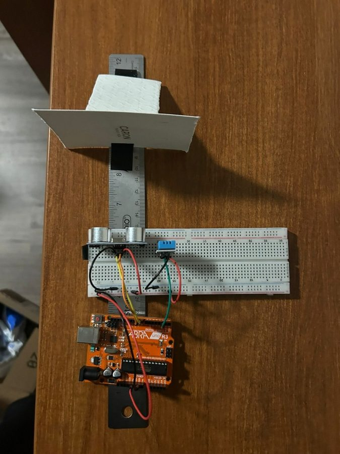
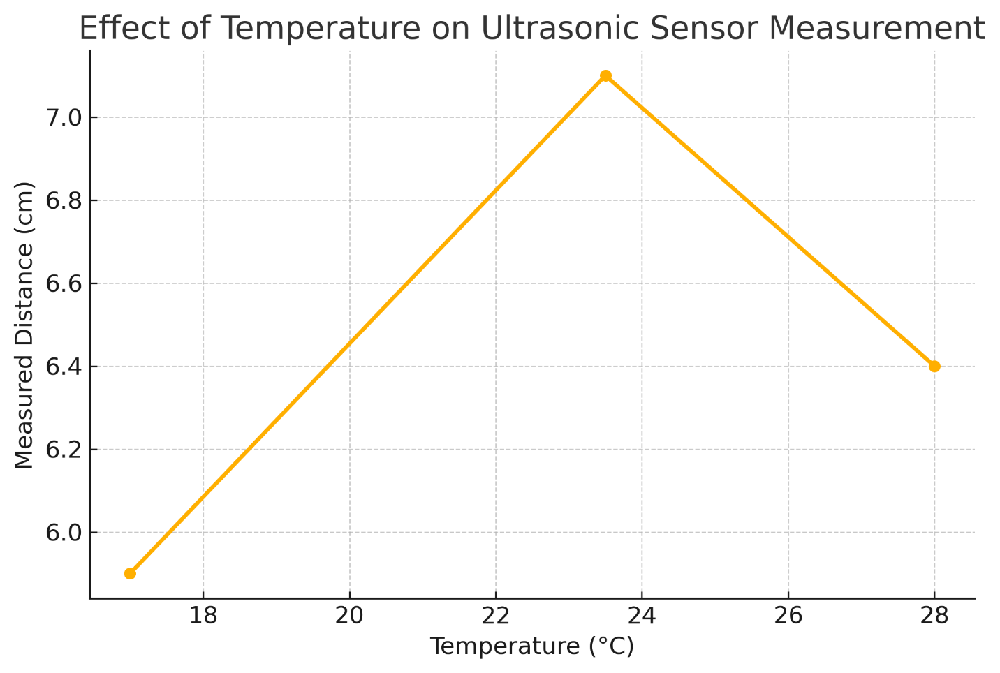

# DDMC Smart Bot: Raspberry Pi Motor Control with Ultrasonic Sensing

A two-wheel robot built on a **Raspberry Pi Zero**, written in **C**. It combines dual DC motor control through an L293D H-bridge, obstacle detection with an HC-SR04 ultrasonic sensor, camera capture, and daily data logging. A non-blocking **ncurses** terminal UI drives the robot while the sensor keeps sampling in the background.

Joshua Mshelia & Iddi Munkaila · EECE72030 (Computer Systems Engineering Project 3), Conestoga College · Fall 2025

<p align="center">
  
  
</p>

## Features

- **Dual motor control**: forward, reverse, spin left/right, and stop through the L293D. Two speed presets (50% / 90%) use software PWM.
- **Safe direction changes**: motors are always stopped and given a 300 ms pause before reversing, to prevent current surges.
- **Ultrasonic ranging**: the HC-SR04 timing protocol, with microsecond timeouts so the loop never blocks on a missing echo. Error codes: `-1` no echo, `-2` echo timeout, `-3` out of range.
- **Auto-stop safety**: the robot halts after **3 consecutive readings under 40 cm**. Requiring three hits filters out single noisy readings without missing real obstacles.
- **Non-blocking ncurses UI**: live movement state, speed, distance, and last event. Keys respond instantly while sensing continues.
- **Camera capture**: press `c` to save a timestamped JPEG with `rpicam-jpeg`.
- **Daily rotating logs**: timestamped distance readings, with a new file started automatically each day.



## Hardware

| Component | Qty | Role |
|---|---|---|
| Raspberry Pi Zero W | 1 | Main controller |
| L293D dual H-bridge | 1 | Bidirectional motor driver |
| 6 V geared DC motors | 2 | Drive wheels |
| HC-SR04 ultrasonic sensor | 1 | Distance measurement (ECHO goes through a voltage divider to 3.3 V) |
| Raspberry Pi Camera Module V2 | 1 | Still image capture |
| Power bank + separate motor supply | 1 | Pi and motors are powered separately, with a common ground |
| Breadboard, jumpers, tape | – | Wiring |

### Pin mapping (wiringPi numbering)

| Signal | wiringPi | BCM | Connects to |
|---|---|---|---|
| Motor A IN1 / IN2 | 0 / 1 | GPIO17 / GPIO18 | L293D IN1 / IN2 |
| Motor A enable (PWM) | 2 | GPIO27 | L293D ENA |
| Motor B IN3 / IN4 | 3 / 4 | GPIO22 / GPIO23 | L293D IN3 / IN4 |
| Motor B enable (PWM) | 5 | GPIO24 | L293D ENB |
| Ultrasonic TRIG | 21 | GPIO5 | HC-SR04 TRIG |
| Ultrasonic ECHO | 22 | GPIO6 | HC-SR04 ECHO (via divider) |

<details>
<summary>Full wiring table</summary>


</details>

## Software design

The program is one C file organized into modules, all coordinated by a single non-blocking main loop:



| Module | Key functions |
|---|---|
| Motor control | `both_forward()`, `both_backward()`, `spin_left()`, `spin_right()`, `motor_stop()`, `apply_speed_if_moving()` |
| Ultrasonic | `getDistance()`, `wait_for_level()` |
| Logging | `ensure_log_file()`, `log_distance()` |
| Camera | `take_photo()` |
| UI | `draw_header()`, `draw_controls()`, `draw_status()` |

## Build & run

On the Raspberry Pi, with [wiringPi](https://github.com/WiringPi/WiringPi) and ncurses installed:

```bash
sudo apt install libncurses-dev
make          # builds ./robot
make run      # runs with sudo (needed for GPIO access)
```

Logs and photos are saved to the paths set by `LOG_DIR` and `PHOTO_DIR` at the top of [`src/motor_control_with_sensors.c`](src/motor_control_with_sensors.c).

| Key | Action |
|---|---|
| `w` / `s` | Forward / backward |
| `a` / `d` | Spin left / right |
| `x` | Stop |
| `1` / `2` | Speed 50% / 90% |
| `c` | Capture photo |
| `h` | Redraw controls |
| `Space` / `Esc` | Exit |

## Testing & results

**PWM validation.** Oscilloscope traces confirmed a stable frequency and the correct duty cycle at both speed presets.

| 50% duty cycle | 90% duty cycle |
|---|---|
|  |  |

**Ultrasonic temperature drift.** We measured a fixed target (~7 cm) at 17 °C, 23.5 °C and 28 °C. Readings shifted with temperature, as expected, because the speed of sound changes with air temperature. Overall accuracy was within ±1–3 cm, depending on temperature, surface, and angle.

| Test rig | Results |
|---|---|
|  |  |

Experiment videos: [cold / outdoor](media/temp_test_outdoor_cold.mp4) · [heat source](media/temp_test_heat_source.mp4) · [live readings](media/temp_test_readings.mp4) · [robot drive demo](media/robot_drive_demo.mp4)

**Integrated test.** The robot ran for 10 minutes without a crash. It responded to every key press, updated distance every 2 s, auto-stopped reliably after three close readings, and capturing photos didn't freeze the UI.

## Challenges & solutions

| Problem | Fix |
|---|---|
| Missed or garbled ultrasonic echoes | Timeout-based `wait_for_level()`, a 2 ms TRIG settle time, error codes, and the 3-hit filter |
| Motor jitter and sensor brownouts | Separate supplies for the Pi and the motors with a common ground, plus a stop delay before reversing |
| False auto-stops from noisy readings | Require 3 consecutive close readings and reset the count on any clear reading |
| Camera capture stalling the loop | Switched to `rpicam-jpeg` with output sent to `/dev/null`, triggered only on key press |
| Blocking keyboard input | ncurses `timeout(0)` with partial screen redraws |
| Logs breaking at midnight or on a missing directory | Auto-create the directory, rotate the file by date, and `fflush` every write |

## Limitations & next steps

- Move from software PWM to **hardware PWM** (pigpio, GPIO12/13) for smoother low-speed control.
- Add **wheel encoders** for closed-loop speed control and distance-based moves.
- Split the single source file into separate modules (`motor.c`, `sensor.c`, `camera.c`, `log.c`).
- Use the camera for basic computer vision (obstacle or line detection).

## Repository layout

```
src/motor_control_with_sensors.c   Final Phase 2 program
legacy/week2_led_pwm.c             Early PWM LED exercise (signal-driven 1 ms tick)
docs/                              Images and demo GIF
media/                             Demo and experiment videos
Makefile
```

The weekly development history is kept on branches: `week1_setup`, `week2_pwm_led`, `pwm_single_motor`, `pwn_dual_motor`, `phase1_demo`, `Ultrasonic_Sensor_Test`, `Ncurses-initial-commit`, and `phase-2-final`.
